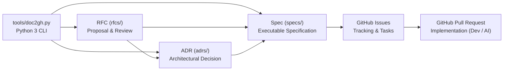

# doc2gh

Software documentation architecture designed for **AI-driven development** and seamless integration with **GitHub** (Issues, Pull Requests, and Actions), built to be embedded into target repositories via **Git Subtree**.

---

## Overview

**doc2gh** provides a structured, traceable, and enforceable documentation model for software engineering projects:

1. **Three Core Document Types**:
   - **RFCs (`rfcs/`)**: Technical proposals and design discussions reviewed through Pull Requests.
   - **ADRs (`adrs/`)**: Immutable Architecture Decision Records capturing key architectural choices and constraints.
   - **Specs (`specs/`)**: Executable functional and technical specifications with task breakdowns for developers and AI agents.
2. **CLI-Managed Governance (`tools/doc2gh.py`)**:
   - Every document contains a dedicated **Document Management** section (and synchronized YAML Frontmatter) that tracks status, timestamps, and GitHub Issue/PR links.
   - This management area **must not be edited manually**—all status transitions and GitHub metadata updates are performed through the included Python 3 CLI (`tools/doc2gh.py`).
3. **GitHub & AI Integration**:
   - GitHub Actions workflows automatically validate document structure and management blocks, synchronize documents with GitHub Issues, and post traceability summaries on Pull Requests.
   - Templates include explicit sections guiding AI coding assistants on architectural rules, target modules, acceptance criteria, and verification steps.
4. **Git Subtree Ready**:
   - The root of this project represents the exact directory tree to be mounted into a host project's documentation folder (e.g., `doc/` or `docs/`).

---

## Directory Structure

```text
.
├── README.md               # Architecture overview, AI guidelines, and Git Subtree usage
├── adrs/                   # Architecture Decision Records
│   ├── README.md           # ADR lifecycle, naming conventions, and AI rules
│   └── template.md         # Standard ADR template with managed governance block
├── rfcs/                   # Requests for Comments
│   ├── README.md           # RFC lifecycle, review workflow, and AI guidelines
│   └── template.md         # Standard RFC template with managed governance block
├── specs/                  # Technical & Functional Specifications
│   ├── README.md           # Spec lifecycle, task breakdown, and AI execution guide
│   └── template.md         # Standard Spec template with managed governance block
├── tools/                  # Python 3 CLI for managing document status and metadata
│   ├── README.md           # CLI reference and usage examples
│   └── doc2gh.py           # Zero-dependency Python 3 management utility
└── workflows/              # GitHub Actions workflows for validation and issue/PR sync
    ├── README.md           # Setup and permissions guide for host repositories
    ├── doc-lint.yml        # Validates frontmatter, naming, and managed sections on PRs
    ├── doc-sync-issues.yml # Automatically creates/updates GitHub Issues from documents
    └── pr-doc-link.yml     # Posts document traceability summaries on Pull Requests
```

---

## Documentation & GitHub Workflow



---

## Managing Document Status (`tools/doc2gh.py`)

Each document has a dedicated management region delimited by `<!-- DOC2GH:MANAGEMENT:START ... -->` and `<!-- DOC2GH:MANAGEMENT:END -->`, paired with managed YAML frontmatter fields. **Do not edit these areas manually.**

Use the bundled Python 3 tool (`tools/doc2gh.py` or `doc/tools/doc2gh.py` when mounted in `doc/`):

```bash
# Create a new document (auto-increments ID and initializes the managed section)
python3 tools/doc2gh.py new rfc "Async Webhook Delivery" --issue "#10"
python3 tools/doc2gh.py new adr "Use PostgreSQL for Transactional Storage" --issue "#12"
python3 tools/doc2gh.py new spec "Webhook Retry Worker" --issue "#15"

# Update document status and link Pull Requests / Issues
python3 tools/doc2gh.py status ADR-0001 accepted --pr "#14"
python3 tools/doc2gh.py status SPEC-0001 in-progress --pr "#18"

# Link or update GitHub Issue / PR references without changing status
python3 tools/doc2gh.py link SPEC-0001 --issue "#15" --pr "#18"

# Validate all documents and verify that managed sections were not tampered with
python3 tools/doc2gh.py validate
```

See [`tools/README.md`](./tools/README.md) for the complete CLI documentation.

---

## Using as a Git Subtree

### 1. Add `doc2gh` to a Host Repository

From the root of the target repository, mount `doc2gh` into `doc` (or `docs`):

```bash
git subtree add --prefix=doc https://github.com/<org>/doc2gh.git main --squash
```

### 2. Enable GitHub Actions Workflows in the Host Repository

GitHub Actions requires workflow YAML files to reside in `.github/workflows/` at the root of the repository. Copy the bundled workflows from the subtree directory:

```bash
mkdir -p .github/workflows
cp doc/workflows/*.yml .github/workflows/
```

See [`workflows/README.md`](./workflows/README.md) for required repository permissions.

### 3. Pull Upstream Updates from `doc2gh`

```bash
git subtree pull --prefix=doc https://github.com/<org>/doc2gh.git main --squash
```

### 4. Contribute Improvements Back to `doc2gh` (Optional)

```bash
git subtree push --prefix=doc https://github.com/<org>/doc2gh.git feature/update-templates
```

---

## Guidelines for AI Agents

When operating inside a repository powered by **doc2gh**, AI agents must follow these rules:

1. **Never manually edit the managed section**: Always invoke `python3 tools/doc2gh.py` (or `python3 doc/tools/doc2gh.py`) to create documents, transition `status`, or update `github_issue` / `github_pr` fields.
2. **Before writing code**:
   - Run `python3 tools/doc2gh.py list --type adr --status accepted` and read the accepted **ADRs** to respect active architectural constraints.
   - Read the target **Spec** in `specs/` to understand functional requirements, technical design, acceptance criteria, and task checklists.
3. **During and after implementation**:
   - Check off completed task items (`- [ ]` -> `- [x]`) in the Spec body.
   - Use `python3 tools/doc2gh.py status <DOC-ID> <new-status>` to reflect progress (`in-progress`, `done`, `implemented`).
   - Reference the document ID (`SPEC-NNNN`, `ADR-NNNN`, `RFC-NNNN`) and GitHub Issue (`#123`) in commit messages and Pull Request descriptions.
