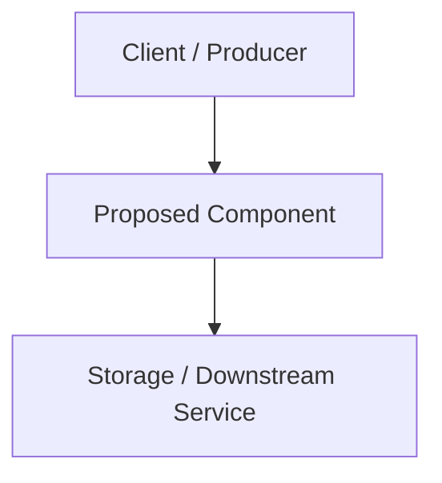

---
# ============================================================================
# MANAGED BY doc2gh CLI (tools/doc2gh.py) — DO NOT EDIT THIS BLOCK MANUALLY
# ============================================================================
id: RFC-0000
type: rfc
title: "Descriptive title of the technical proposal"
status: draft
created_at: YYYY-MM-DD
updated_at: YYYY-MM-DD
github_issue: ""
github_pr: ""
# ============================================================================
authors:
  - "@github-username"
reviewers: []
related_adrs: []
target_specs: []
tags: []
---

# RFC-0000: Descriptive title of the technical proposal

<!-- DOC2GH:MANAGEMENT:START - DO NOT EDIT THIS SECTION MANUALLY. Use `python3 tools/doc2gh.py` to manage status and GitHub links. -->
## Document Management (Managed by doc2gh)

> [!WARNING]
> **Do not edit this section or the managed frontmatter fields manually.**
> All status transitions and GitHub tracking links must be updated via `python3 tools/doc2gh.py`.

| Field | Value |
| :--- | :--- |
| **Document ID** | `RFC-0000` |
| **Type** | `RFC` |
| **Status** | `draft` |
| **Created At** | `YYYY-MM-DD` |
| **Updated At** | `YYYY-MM-DD` |
| **GitHub Issue** | _None_ |
| **GitHub PR** | _None_ |
<!-- DOC2GH:MANAGEMENT:END -->

## Executive Summary

Provide a concise (1–2 paragraphs) summary explaining what is being proposed and the expected value.

## Motivation

- What problem are we solving?
- Why is it important to solve it now?
- Who are the affected users, services, or workflows?

## Goals and Non-Goals

### Goals (In-Scope)
- Measurable objective 1
- Measurable objective 2

### Non-Goals (Out-of-Scope)
- What this proposal explicitly **will not** address

## Detailed Design / Proposal

Describe the proposed technical solution in sufficient depth for engineering review:
- High-level architecture (Mermaid diagrams encouraged)
- Data model changes, API contracts, or public interfaces
- Core execution flows and error handling strategies

## Impact, Risks, and Compatibility

- **Breaking Changes**: Does this break backward compatibility? How will migration be handled?
- **Security & Privacy**: Authentication, authorization, data protection, or attack-surface considerations.
- **Performance & Operations**: Resource usage, observability, metrics, and rollout strategy.

## Alternatives Considered

### Alternative A: [Name]
- **Description**: Brief overview of the alternative approach.
- **Reason for Rejection**: Why the primary proposal was chosen instead.

## Open Questions

- [ ] Open question 1 to be resolved during Pull Request review
- [ ] Open question 2

## Adoption Plan & Follow-up Artifacts (GitHub & AI)

Once this RFC is approved (`status: approved`), generate the following downstream artifacts using `python3 tools/doc2gh.py`:

- **ADRs to Create**:
  - [ ] `ADR-NNNN`: [Title of architectural decision derived from this RFC]
- **Specs to Create**:
  - [ ] `SPEC-NNNN`: [Title of executable specification for implementation]
- **Tracking Issues**:
  - [ ] Create or link implementation Epic/Issues in GitHub
